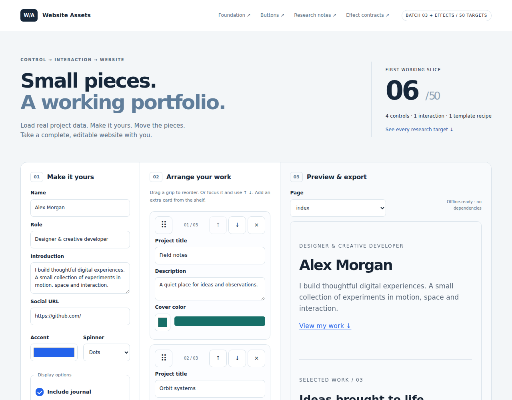

# Frontend Queue verification — 50 targets

**Passed: 10 Node tests, 2 Studio core tests, 15 Chromium scenarios and 2 unmodified REA scenarios.** Checked 2026-11-04.

- [Successful workflow](https://github.com/zczxz3/website-assets/actions/runs/41781526357)
- [Tested source](https://github.com/zczxz3/website-assets/tree/e84d571299b63d8c66b447ce52b8c8f5e8fd02cf)
- [Pinned Studio](https://github.com/zczxz3/modular-website-studio/tree/3f989b2be833f468db600c24aa49194abf5f918e)
- [Original evidence archive](queue-verification.zip) and [checksums](queue-verification-manifest.json)

## Verified scope

| Check | Result | Coverage |
|---|---|---|
| Model, export and catalog | 10 tests | Reordering, undo/redo, rejected imports, escaping, routes and ZIP structure; unique IDs, progress preservation, exact CSV checksum, acquisition pins and rejection of false runtime claims |
| Studio core | 2 tests | Seven-file project open/edit/save/reopen/export; static card installation and duplicate rejection |
| Workbench | 14 scenarios | Desktop 1280 px and emulated touch 390 px; 50 targets, 23/17/10 level filters, 26-effect view, two-tool view, no duplicate IDs; original controls, keyboard, request state, cancellation, dragging, ordering, save/open and offline export |
| Studio UI | 1 scenario | Open configured portfolio, edit title, install and insert card ZIP, save, reopen and export while preserving article and all pages |
| REA | 2 scenarios | Standalone menu keyboard activation and open/close at both widths, with original DOM, event and screenshot evidence |
| Integrity | 17 screenshots | Recomputed every screenshot checksum and all 20 recorded source hashes; checked 75 source-archive entries including 50 research folders |

The Studio production build and deterministic archive rebuild passed. Runtime: Node 24.22.1, REA 6.8.0 and its matching Playwright Chromium. Exact runtime details are preserved in the evidence ZIP. Studio core and its opaque editing iframe were not changed.

## Progress and limits

The catalog now has **50 targets: 6 bounded implementations, 41 queued targets and 3 reference-only entries**. B07–B10, A05 and F03 retain their earlier verified implementations. A09, A10 and F10 remain reference-only.

**E01–E20 are planned effect contracts, not 20 newly working components.** This update verifies their catalog integrity, filtering, documentation and export in the research source pack. It does not claim to verify their visual behavior or to install them into Studio. See [effect contracts and reuse candidates](QUEUE_EFFECTS.md).

Acquisition has 38 clone candidates, one official download and 11 study references. Native CSS/SVG study references remain eligible for independent implementation. Typed.js v3 is excluded from permissive runtime bundling; E05 is planned as original JavaScript. Source metadata and pins do not constitute complete upstream builds or dependency/asset license audits.

Mobile testing uses Chromium touch and viewport emulation, not real iOS/Android devices. Safari, Firefox, assistive-technology audits, full WCAG conformance, measured effect performance budgets and upstream whole-site reconstruction are outside these results. Dragging has no automatic edge scrolling; keyboard and move buttons remain available.

The prior 30-target verification is preserved at [commit e2b5d3b](https://github.com/zczxz3/website-assets/blob/e2b5d3b552d70a4a8db9dfb03d5e10188e0659f0/QUEUE_VERIFICATION.md). Its results are superseded by this run for the updated queue.

## Downloads

- [Source with 50 research folders](queue-source.zip): **316,278 bytes**, 75 entries.
- [Offline website](queue-website.zip), [editable Studio project](queue-portfolio.mws.json), [installable static card](queue-card.zip).
- Evidence archive: **1,413,728 bytes**.

```text
source SHA-256   012755ebb4d17df77d325e55b777e1bd1a0ded4b79f52878e7c5fd08b6937ad5
evidence SHA-256 2ae123817c02858e541ea0c891d8b7d44e564c87fea2e7cf14d5ee23a905e207
```


