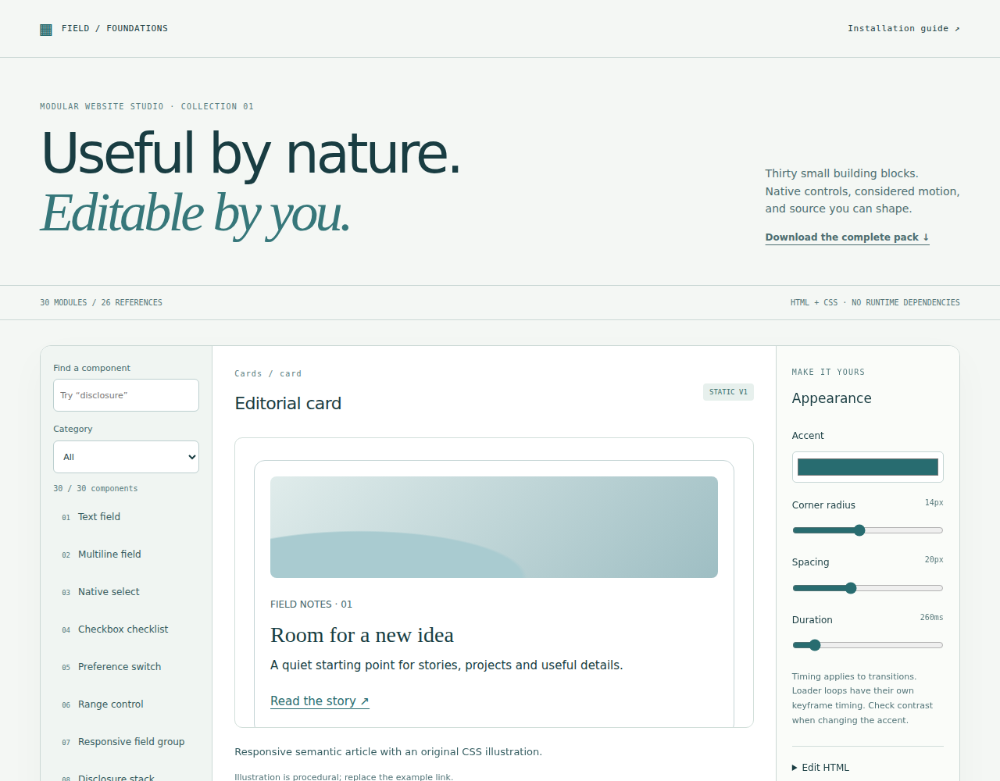

# Website Assets — Motion Atlas

25 distinctive website references, 16 button resources and 26 foundation resources, with independently written reusable interaction studies and installable Studio modules. Lists overlap; these are topic counts, not unique-site counts. English research, code and integration notes.

**Version 0.3 verified:** 58/58 REA browser scenarios, 17/17 Node checks and 41/41 source comparisons passed. [Verification](STUDY_VERIFICATION.md).


## Button topic

[Button Atlas research](BUTTON_RESEARCH.md) adds 20 original native-button components across 10 families. [Component contracts and API](BUTTON_COMPONENTS.md). Start a local HTTP server and open `buttons.html`; every button file is directly available in the repository and needs no source ZIP extraction. [Button verification](BUTTON_VERIFICATION.md): 45 Playwright scenarios, 2 REA scenarios and 7 Node tests passed. Original reference capture limitations are recorded separately from the 25-site checks below.

## Modular Website Studio foundations

[Foundation guide](FOUNDATION_GUIDE.md) adds **30 installable static modules**: 20 native fields, disclosures, cards, navigation, feedback, data and layout patterns, plus 10 Button Atlas adaptations. [Review of 26 resources](FOUNDATION_RESEARCH.md) separates usable static sources, framework/runtime adapters, generators and unresolved licenses.

Download [foundation-pack.zip](foundation-pack.zip), extract it, then install one ZIP from `installable/` using Studio's **模块 → ＋ 安装模块 ZIP**. Or open [foundation-showcase.mws.json](foundation-showcase.mws.json) as a complete editable project. Run a local server and open `foundation.html` for filtering, live theme/HTML editing and customized module ZIP downloads. Exported modules have no runtime dependencies; original source and MIT notices are included.

[Foundation verification](FOUNDATION_VERIFICATION.md): **33 Studio core tests, 63 Chromium scenarios and 2 REA scenarios passed**, including real UI installation of all 30 modules and a save/reopen/export round trip. This pack does not enable script modules in Studio.



## Frontend Queue — Batch 03

[30-target queue and English analysis](QUEUE_RESEARCH.md): 10 controls, 10 advanced interactions and 10 websites/apps. Six bounded original studies connect **menu, loading, selection and spinner controls → project ordering → an editable portfolio**. The remaining 21 implementations are queued; React Bits, GSAP and Lusion are reference-only.

Open `queue.html` with a local HTTP server. Edit project data, drag or use keyboard controls, save/reopen edits, and export linked offline HTML pages or a Studio project. [Source pack](queue-source.zip), [ready-made website](queue-website.zip), [Studio project](queue-portfolio.mws.json), [installable static card](queue-card.zip), and [verification](QUEUE_VERIFICATION.md). This is an original static portfolio recipe, not a complete port of the upstream Next.js application.

[Queue verification](QUEUE_VERIFICATION.md): **8 Node tests, 2 Studio core tests, 15 Chromium scenarios and 2 REA scenarios passed**. [Reusable API examples](QUEUE_COMPONENTS.md).


## Research and components

- [Batch two: references 16–25](BATCH_TWO.md): terrain, GLSL grain/distortion, horizontal comic, camera narrative, infinite posters, sound, runner, SDF bubbles, isometric navigation and engineering drawings.
- [Consolidated research](RESEARCH.md) and [delivery overview](OVERVIEW.md).
- [Component API](COMPONENT_API.md) and directly browsable [module source](components/).
- [Original renderer limitations](BROWSER_LIMITATIONS.md).
- [Machine-readable checksums and coverage](verification-manifest.json).

These are component-level technique reconstructions. Exact original routes, artwork, complete timelines, character rigs, physical cloth and production datasets are outside the verified scope. Every new study records the implementation difference. Original code is MIT-licensed; original-site reference material retains its own rights.

## Run

```sh
python3 -m zipfile -e study-source.zip .
python3 -m http.server 8000
```

Open `http://localhost:8000`. The gallery has no runtime npm dependency. Shared modules are directly available; the 25 full site directory trees, six research sections each, are inside `study-source.zip`.

`mount(host)` returns `destroy()`. Keep shared module dependencies and include `styles.css`. New shader modules need WebGL; sound requires an explicit action. Motion preference, pause, offscreen suspension and cleanup follow the shared runtime.

## Reproduce verification

```sh
node --test component-tests.mjs
python3 package_studies.py verify
```

The GitHub workflow uses pinned REA 6.8.0 on a standard Ubuntu runner. The component archive is `component-verification.zip`; original second-batch evidence is `batch-two-reference-evidence.zip`. Artifact files are preserved in the repository as well as Actions, so the research does not rely on Actions retention.
