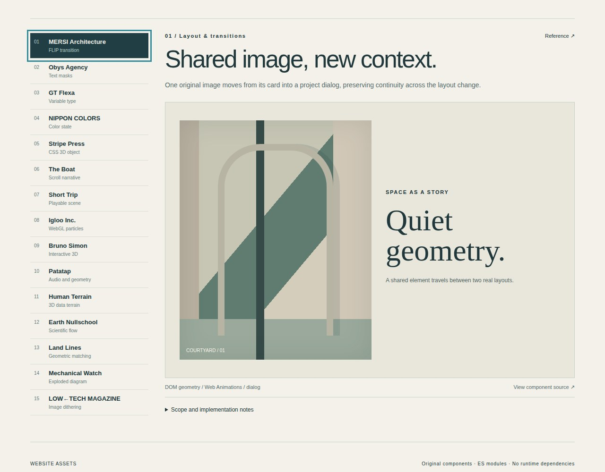

# Website Assets — Motion Atlas

Research of 15 distinctive websites, with original reusable frontend interaction studies. All documentation and code comments are in English.

**Verified:** 31/31 real REA browser checks and 6/6 algorithm checks passed. See [the measured verification report](STUDY_VERIFICATION.md).



## What is implemented

- 15 independent runnable studies, from editorial transitions and variable typography to WebGL particles, projected 3D worlds, flow fields, line matching and dithering.
- Directly browsable shared module source in `components/`, with a common `mount()` / `destroy()` lifecycle.
- An interactive gallery: `index.html`, `index.mjs`, `registry.mjs` and `styles.css`.
- A complete `study-source.zip` package with all 15 separate research directories, evidence, analysis, original asset notes, standalone demos, reusable exports and reproduction instructions.
- Bounded REA captures of all 15 original public pages, with completeness and unverified production details recorded honestly.

This is a first-pass component library and research package, not a complete or pixel-identical reconstruction of all 15 websites. See [the findings](RESEARCH.md) for exact coverage and differences.

## Run locally

```sh
python3 -m http.server 8000
```

Open `http://localhost:8000`. The supplied gallery and components use native browser APIs and require no npm installation.

To expand all per-site research folders, standalone demo pages and reference screenshots:

```sh
python3 -m zipfile -e study-source.zip .
```

Then serve the root and open a standalone page under `sites/<site>/04-reconstruction/index.html`.

## Research and reuse

- [Research findings and observed technology](RESEARCH.md)
- [Component API and integration](COMPONENT_API.md)
- [Original project catalog](WEBSITE_CATALOG.md)
- [Pinned REA runtime verification](REA_VERIFICATION.md)
- [Component verification report and preserved evidence](STUDY_VERIFICATION.md)
- [First original-site capture run](https://github.com/zczxz3/website-assets/actions/runs/41750252643)
- [Desktop/mobile component verification run](https://github.com/zczxz3/website-assets/actions/runs/41754711044)

The original studies use procedural artwork, synthesized sound and clearly labeled synthetic data. Original implementation code is MIT-licensed; reference screenshots and third-party materials keep their own rights. GT Flexa's commercial font, site photography, original game assets, sound recordings and production geographic datasets are not bundled as reusable material.

## Verification

`node --test component-tests.mjs` checks mathematical and algorithmic invariants. The Verify independent studies workflow additionally uses the real REA CLI to run an interaction in every study at desktop width 1280 and mobile width 390, with evidence, page-error checks and screenshots. A further gallery check verifies teardown and repeated mounting, for 31 browser checks in total. Read the workflow result rather than treating this description as a passing-test claim.

REA 6.8.0 runs on a normal GitHub-hosted Ubuntu runner with its standard ownership checks. The current Work container's process namespace and browser IPC limitations remain unchanged. No additional model API key or repository secret is required.
